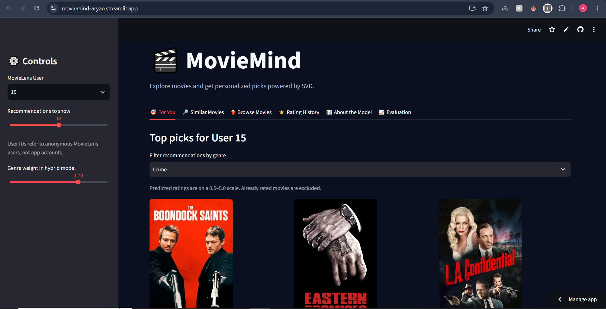
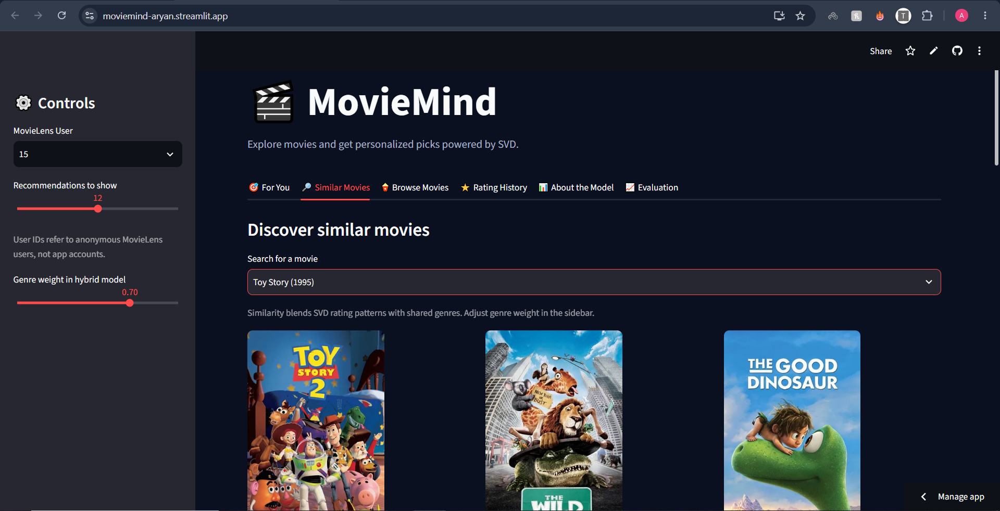

# 🎬 MovieMind — Personalized Movie Recommendation System

**MovieMind** is a machine learning-powered movie recommendation web application that helps users discover movies based on their rating history and genre preferences.

The application combines **Singular Value Decomposition (SVD) collaborative filtering** with genre-based recommendation techniques. It also integrates movie posters from TMDB and provides an interactive evaluation dashboard.

### 🌐 Live Demo

**[Try MovieMind](https://moviemind-aryan.streamlit.app/)**

**[GitHub Repository](https://github.com/Aryan5859/personalized-movie-recommender)**

## ✨ Features

- **Personalized Recommendations:** Generate top-N movie recommendations for MovieLens users based on predicted ratings.
- **Hybrid Recommendation System:** Combine SVD predictions with preferences learned from previously rated movie genres.
- **Similar Movie Discovery:** Find related movies using learned movie embeddings and genre similarity.
- **Movie Browsing:** Search movie titles, filter by genre, and sort by popularity or release year.
- **Rating History:** Explore each user's previous ratings, average rating, and rating distribution.
- **Movie Posters:** Display movie posters using The Movie Database (TMDB) API.
- **Model Evaluation:** Evaluate SVD performance using RMSE, MAE, Precision@K, and Recall@K.
- **Interactive Web Interface:** Explore recommendations through a Streamlit dashboard.

## 📸 Application Screenshots

### Personalized Movie Recommendations

Explore personalized movie recommendations generated using collaborative filtering and genre preferences.



### Hybrid Similar Movie Discovery

Discover similar movies by combining SVD movie embeddings with genre similarity.



### Model Evaluation Dashboard

Evaluate the SVD baseline using RMSE, MAE, Precision@10, and Recall@10.


## 🛠️ Technology Stack

| Technology | Purpose |
|---|---|
| Python | Core programming language |
| Streamlit | Interactive web application |
| Pandas | Data preprocessing and manipulation |
| NumPy | Numerical computations |
| Scikit-surprise | SVD collaborative filtering |
| Scikit-learn | Machine learning utilities |
| TMDB API | Movie poster retrieval |
| MovieLens | Movie ratings and metadata |
| GitHub | Version control |
| Streamlit Community Cloud | Web application deployment |

## 🧠 How MovieMind Works

### 1. Data Preparation

MovieMind uses the MovieLens `ml-latest-small` dataset, containing approximately:

- 610 users
- 9,742 movies
- 100,836 ratings

The application loads movie metadata, ratings, and movie identifiers used to retrieve posters from TMDB.

### 2. Collaborative Filtering with SVD

MovieMind uses matrix factorization to learn patterns from historical user-movie ratings.

The SVD model learns latent representations of users and movies, allowing it to estimate ratings for movies a user has not previously rated.

Movies with higher predicted ratings are ranked as stronger recommendations.

### 3. Hybrid Recommendations

The hybrid recommendation system incorporates genre information alongside SVD predictions.

For personalized recommendations, MovieMind calculates genre preferences from each user's rating history and combines them with predicted ratings.

For similar-movie discovery, it blends cosine similarity between learned movie embeddings with genre similarity.

Users can adjust the genre weighting through an interactive slider.

### 4. Movie Discovery and Visualization

The Streamlit interface provides six sections:

1. **For You:** Personalized recommendations.
2. **Similar Movies:** Discover related titles.
3. **Browse Movies:** Search, filter, and sort the catalog.
4. **Rating History:** Explore user rating activity.
5. **About the Model:** View model information and dataset statistics.
6. **Evaluation:** Calculate model evaluation metrics.

## 📊 Model Evaluation

The SVD model was evaluated using a fixed random 80/20 split of the MovieLens ratings dataset.

| Metric | Result |
|---|---:|
| RMSE | 0.8807 |
| MAE | 0.6766 |
| Precision@10 | 0.642 |
| Recall@10 | 0.678 |

**Evaluation configuration:**

- Training ratings: 80,668
- Testing ratings: 20,168
- Users evaluated: 610
- Relevance threshold: 4.0
- Top K: 10
- Random seed: 42

RMSE and MAE measure rating prediction errors, where lower values indicate better predictions.

Precision@10 and Recall@10 measure relevance within each user's held-out rated movies. They are not full-catalog recommendation metrics.

**Note:** These results evaluate the SVD baseline. The hybrid recommendation component has not yet been independently benchmarked.

## 🏗️ System Architecture

```text
MovieLens Dataset
        |
        v
Data Loading and Preprocessing
        |
        v
SVD Collaborative Filtering
        |
        +--------------------------+
        |                          |
        v                          v
Predicted Ratings           Movie Embeddings
        |                          |
        v                          v
User Genre Preferences      Genre Similarity
        |                          |
        v                          v
Hybrid Recommendations      Similar Movies
        |                          |
        +-------------+------------+
                      |
                      v
              Streamlit Web App
                      |
                      v
                TMDB Posters

Separate Evaluation:
MovieLens Ratings
        |
        v
80/20 Train-Test Split
        |
        v
SVD Baseline Evaluation
        |
        v
RMSE / MAE / Precision@K / Recall@K
```

## 📁 Project Structure

```text
personalized-movie-recommender/
├── .streamlit/
│   └── secrets.toml        # Local credentials (not committed)
├── data/
│   └── .gitkeep
├── models/
├── app.py                  # Streamlit web application
├── recommender_svd.py      # Command-line recommender
├── requirements.txt
├── .gitignore
└── README.md
```

The MovieLens dataset is excluded from Git. The web application automatically downloads the required public dataset files if they are missing.

## 🚀 Installation and Setup

### 1. Clone the repository

```bash
git clone https://github.com/Aryan5859/personalized-movie-recommender.git
cd personalized-movie-recommender
```

### 2. Create a virtual environment

```bash
python -m venv .venv
```

Activate it using Git Bash on Windows:

```bash
source .venv/Scripts/activate
```

### 3. Install dependencies

```bash
pip install -r requirements.txt
```

Python 3.11 is recommended for compatibility with the current dependency configuration.

### 4. Configure TMDB (optional)

Create a `.streamlit/secrets.toml` file:

```toml
TMDB_API_KEY = "YOUR_TMDB_API_KEY"
```

A TMDB API key enables movie posters. The recommendation functionality can still work without it.

Never commit API credentials to GitHub.

### 5. Run the application

```bash
streamlit run app.py
```

Open the local address displayed in the terminal, normally:

`http://localhost:8501`

## 💻 Command-Line Usage

Generate recommendations for a MovieLens user:

```bash
python recommender_svd.py --user 15 --n 10
```

Find similar movies:

```bash
python recommender_svd.py --similar_movie 1 --n 10
```

Run with custom SVD parameters:

```bash
python recommender_svd.py --user 15 --factors 100 --epochs 20
```

## ⚠️ Limitations

- Recommendations are based on historical MovieLens ratings rather than individual accounts created in the web application.
- Cold-start recommendations for completely new users remain a challenge.
- Genre preferences provide a relatively simple content-based signal.
- The hybrid recommendation method has not yet undergone a separate offline evaluation.
- Free cloud hosting may impose resource or performance limitations.

## 🔮 Future Improvements

- Allow visitors to rate movies and build their own recommendation profiles.
- Compare SVD with additional collaborative filtering algorithms.
- Evaluate hybrid recommendations using full-catalog ranking metrics.
- Improve cold-start recommendations.
- Precompute model artifacts to reduce cloud startup and training costs.
- Add richer movie metadata and explanations for recommendations.

## 📚 Data and Attribution

**MovieLens Dataset:** [GroupLens Research](https://grouplens.org/datasets/movielens/)

**Movie Posters:** [The Movie Database (TMDB)](https://www.themoviedb.org/)

This product uses the TMDB API but is not endorsed or certified by TMDB.

## 👨‍💻 Author

**Aryan Tiwari**

- GitHub: [Aryan5859](https://github.com/Aryan5859)
- LinkedIn: [Aryan Tiwari](https://www.linkedin.com/in/aryan-tiwari-1ba436244)

---

**MovieMind — Discover your next favorite movie with machine learning.**